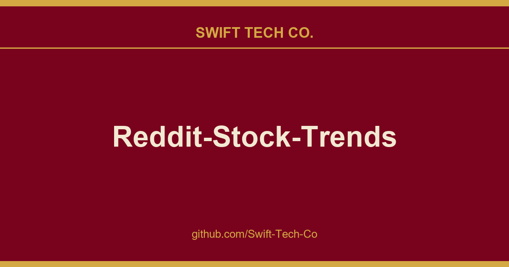

# Reddit-Stock-Trends

## What This Is

Every project needs a shelf of ready answers. product and engineering is one of those shelves, and Reddit-Stock-Trends is the entry on it - the notes, patterns and fixes we reuse when this kind of work comes up.

## Images

[](https://github.com/Swift-Tech-Co)

## Backend

### Reddit API

- Get your reddit API credentials from here.
- Follow this article to get your credentials.
- Go to `back/` directory.
- Create a `praw.ini` file with the following

```
[ClientSecrets]
client_id=<your client id>
client_secret=<your client secret>
user_agent=<your user agent>
```

Note that the title of this section, `ClientSecrets`, is important because `ticker_counts.py` will specifically look for that title in the `praw.ini` file.

### Local usage

- Install required modules using `pip install -r requirements.txt`.
- Run `ticker_counts.py` first.
- Now run `yfinance_analysis.py`.
- You will be able to find your results in `data/` directory.
- [Optional] Run `wsgi.py` to start a server that returns the data in JSON format. This step will generate the csv files if they don't already exist.

## Frontend - Vue

There's also a JavaScript web app that shows some data visualizations.

### Local usage

Start the local server. This server will generate the csv files if they don't already exist.

```bash
cd back
python wsgi.py
```

Then, launch the client

```bash
cd front
cp .env.example .env
npm install
npm run serve
```

You can change the env variables if you need to

### Docker usage

- Requires Docker 17.09.0+ and docker-compose 1.17.0+
- make sure you have .env or a system wide export for the var VUE_APP_API_URL, see env.example
- `docker-compose up -d` to start all services in the background. (-d == detatched)
- `docker-compose up <servicename>` to bring up a specific service.
- `docker-compose rm` removes the image
- `docker-compose ps` to list running services
- `docker-compose up --build` if you made changes to the compose or dockerfiles and need it built into a new image.
- `docker-compose build --no-cache` if you made changes to specific files and docker does not recognize as new thereby reusing cached layers incorrectly.  This takes about 3 minutes on a gaming pc with 0 docker tuning.
- `compose.yml` determines service names and which ports are bound to your host. By default front=8080 back=5006.
- Once `up` navigate to https://swifttechco.com 
- `docker-compose stop` stops all services

---

## Frontend - React

There's also a React JavaScript web app that has +3 more features than the vue app.

- shows all available data on one site/table
- you can sort the data by clicking the header name, if you want see what ticker had the most 5d Change for example
- the tickername is a direct link to the tradeview overview site for the ticker if you find a ticker interesting and want to analyse it

### Local usage

Start the local server. This server will generate the csv files if they don't already exist.

```bash
cd back
python wsgi.py
```

Then, launch the client

```bash
cd react-front
cp .env.example .env
npm install
npm start
```

You can change the env variables if you need to

**No Docker solution for the react app.**

---

#### Ticker Symbol API - EOD Historical Data

Included for potential future use is a csv file that contains all the listed ticker symbols for stocks, ETFs, and
mutual funds (~50,000 tickers). This was retrieved from https://swifttechco.com You can register for a free api key and get up to 20 api calls every 24 hours.

To retrieve a csv of all USA ticker symbols, use the following:

https://swifttechco.com

## Contribution

I would love to see more work done on this, I think this could be something very useful at some point. All contributions are welcome. Go ahead and open a PR.

- Join the Telegram to discuss development and suggestions.

<a href="https://swifttechco.com" ></a>

### To Do

See this page.

Suggestions are appreciated.

---

## Swift Tech Co.

Built and maintained by Swift Tech Co.

AI Automation | FinTech Platforms | Custom Software and Mobile Apps | SaaS Platforms | Cloud Infrastructure | Cybersecurity | SEO and Marketing | API Integration

**Join our community on Telegram:** [t.me/+Qt_eFvkb2rliMzNh](https://t.me/+Qt_eFvkb2rliMzNh)

Home | Services | Careers | Referral Program | Influencers | About | Contact

**Connect**

- Website: swifttechco.com
- LinkedIn: [linkedin.com/in/stephenoladoke](https://www.linkedin.com/in/stephenoladoke/)
- LinkedIn (Company): [linkedin.com/company/swift-tech-co](https://www.linkedin.com/company/swift-tech-co)
- X: [@MrOladoke](https://x.com/MrOladoke)
- Instagram: [@mr.oladoke](https://www.instagram.com/mr.oladoke/)
- Instagram (Company): [@swifttechco](https://www.instagram.com/swifttechco/)
- Organization: [github.com/Swift-Tech-Co](https://github.com/Swift-Tech-Co)

## Sources

Compiled and maintained from upstream [iam-abbas/Reddit-Stock-Trends](https://github.com/iam-abbas/Reddit-Stock-Trends) under permissive open-source license.

---

Maintained by [Swift Tech Co.](https://github.com/Swift-Tech-Co) - [Telegram](https://t.me/+Qt_eFvkb2rliMzNh)

## Sources

Compiled and maintained from upstream [iam-abbas/Reddit-Stock-Trends](https://github.com/iam-abbas/Reddit-Stock-Trends) under permissive open-source license.

---

Maintained by [Swift Tech Co.](https://github.com/Swift-Tech-Co) - [Telegram](https://t.me/+Qt_eFvkb2rliMzNh)